# dare_GAN: diversity-aware robust evaluation GAN

dare_GAN is an image GAN I designed and trained on my own in 2022. It is built on **StyleGAN-XL** and aims at practical, small-data generation for game and interactive-media assets (characters, creatures, items, pixel art).

## Results

FID: lower is better. Each pair below was trained on the same dataset.

| Dataset | Baseline | Baseline FID | dare_GAN FID | Params (baseline → dare_GAN) |
|---|---|---|---|---|
| 260 images, 512×512 | Projected GAN | 57.3 | **14.9** | 37M → 28M |
| 800 Pokémon, 256×256 | StyleGAN-XL | 24.3 | **10.4** | 145M → 56M |
| 8,000 game creatures, 256×256 | DALL·E 2 (unCLIP, extended training) | 9.82 | **3.91** | 1.8B → 240M |
| 18,000 game creatures, 1024×1024 | — | — | **2.38** (recall 52.8%) | 320M |

Recall stayed level with or above the baselines (for example 28.3% vs StyleGAN-XL's 28.6%, and 52% vs DALL·E 2's 47%). The FID gains don't come from collapsing diversity.

## Samples: baseline (left) vs dare_GAN (right), same dataset

**800 images, 256×256: StyleGAN-XL (FID 24.3) vs dare_GAN poke-v7 (FID 10.4)**

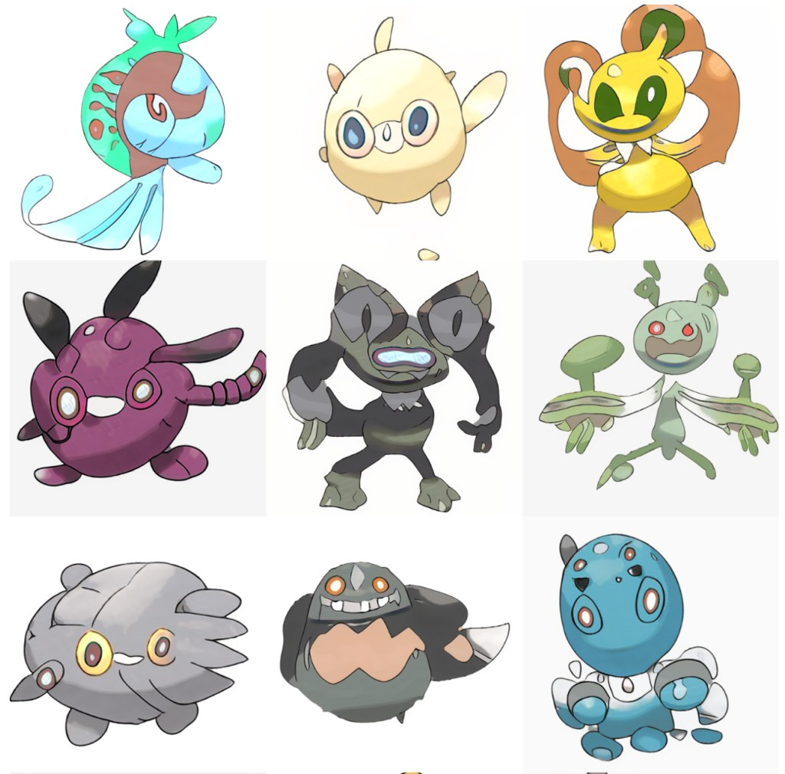 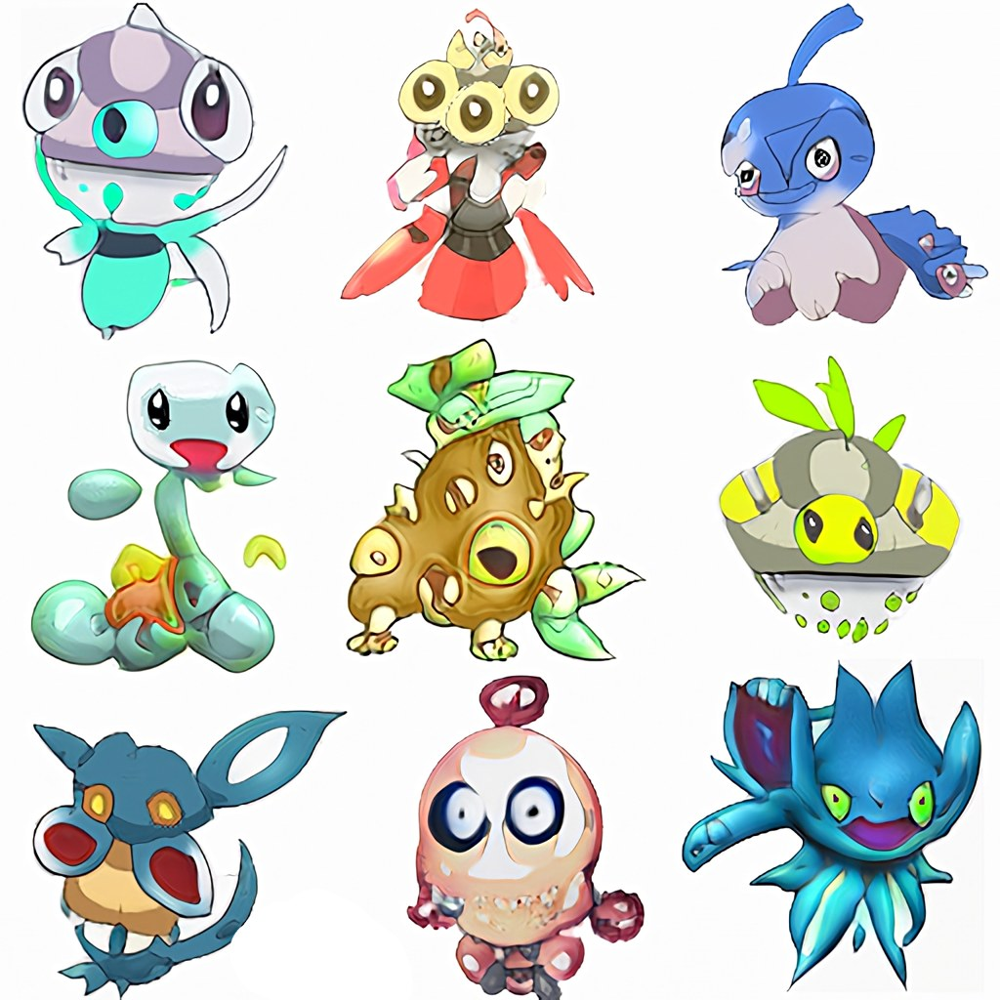

**260 images, 512×512: Projected GAN (FID 57.3) vs dare_GAN outer-v5 (FID 14.9)**

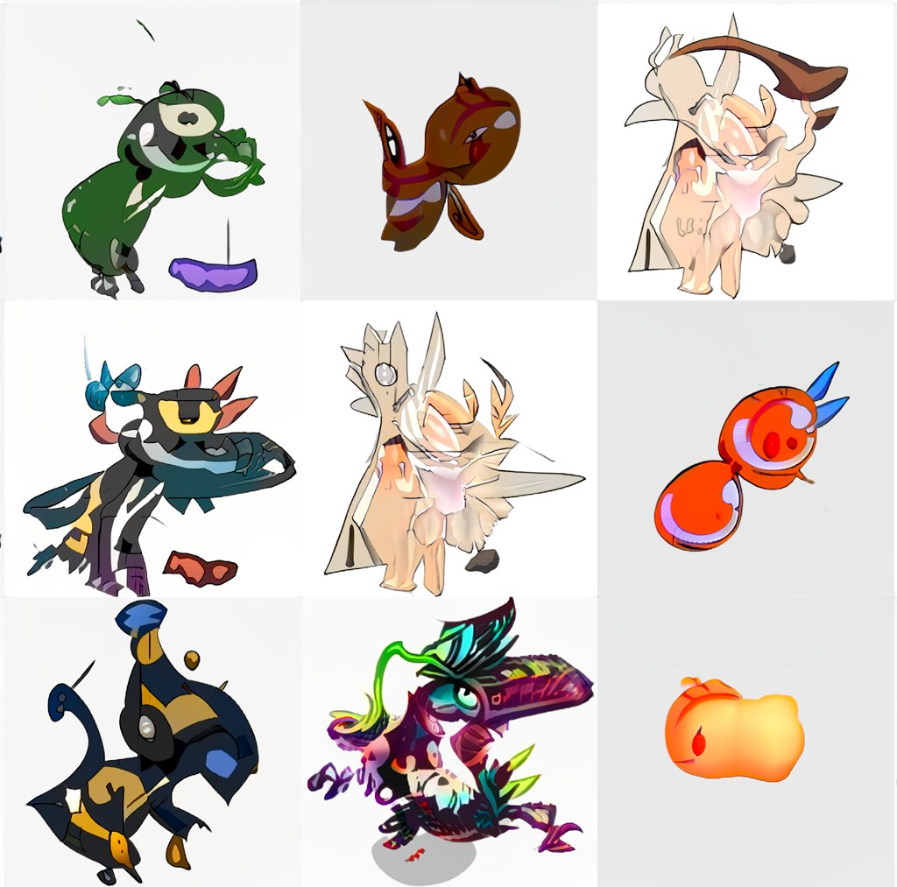 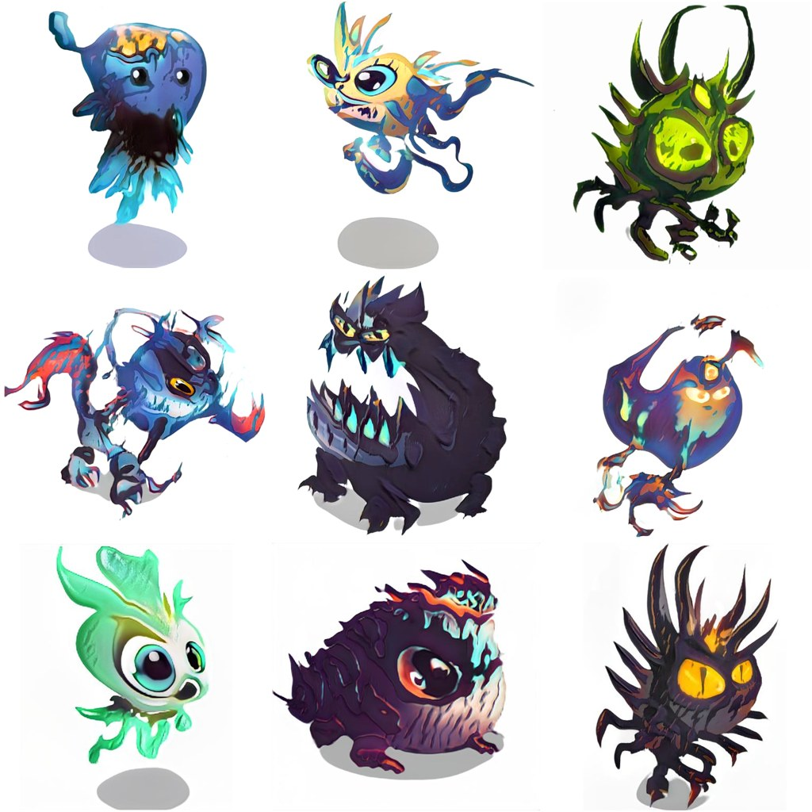

**8,000 images, 256×256: DALL·E 2 unCLIP, extended training (FID 9.82) vs dare_GAN creature-mid (FID 3.91)**

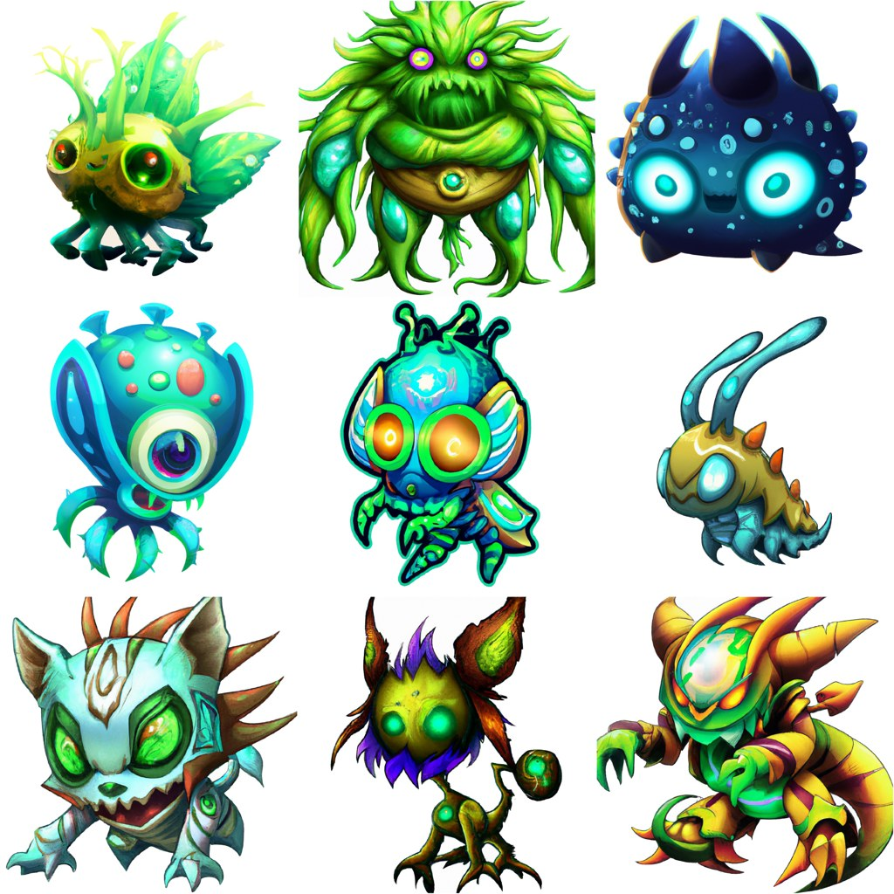 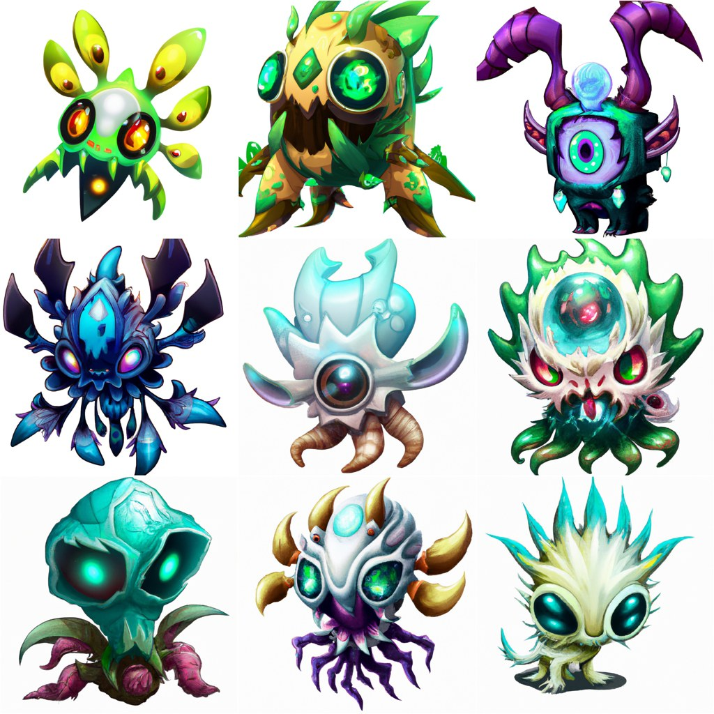

**creature-large: 18,000 images, 1024×1024, FID 2.38**

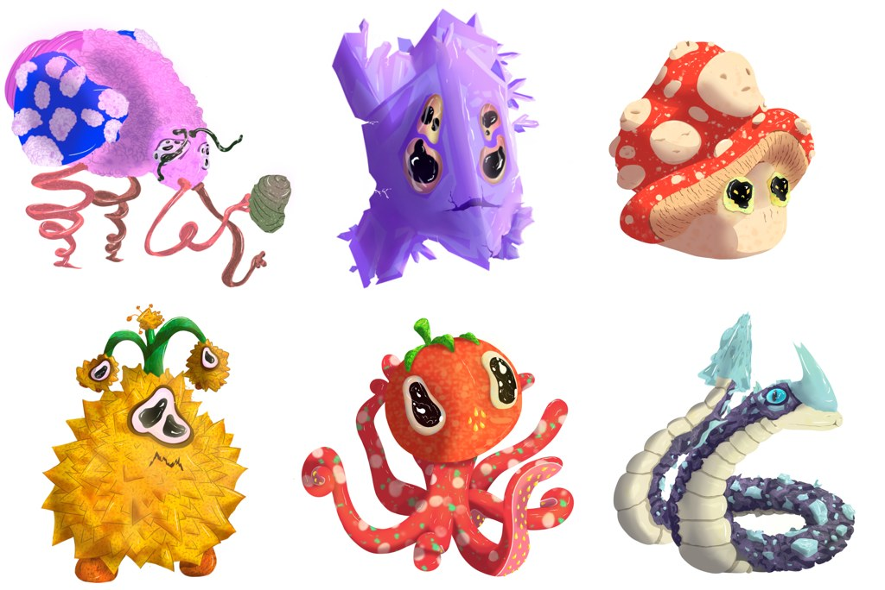 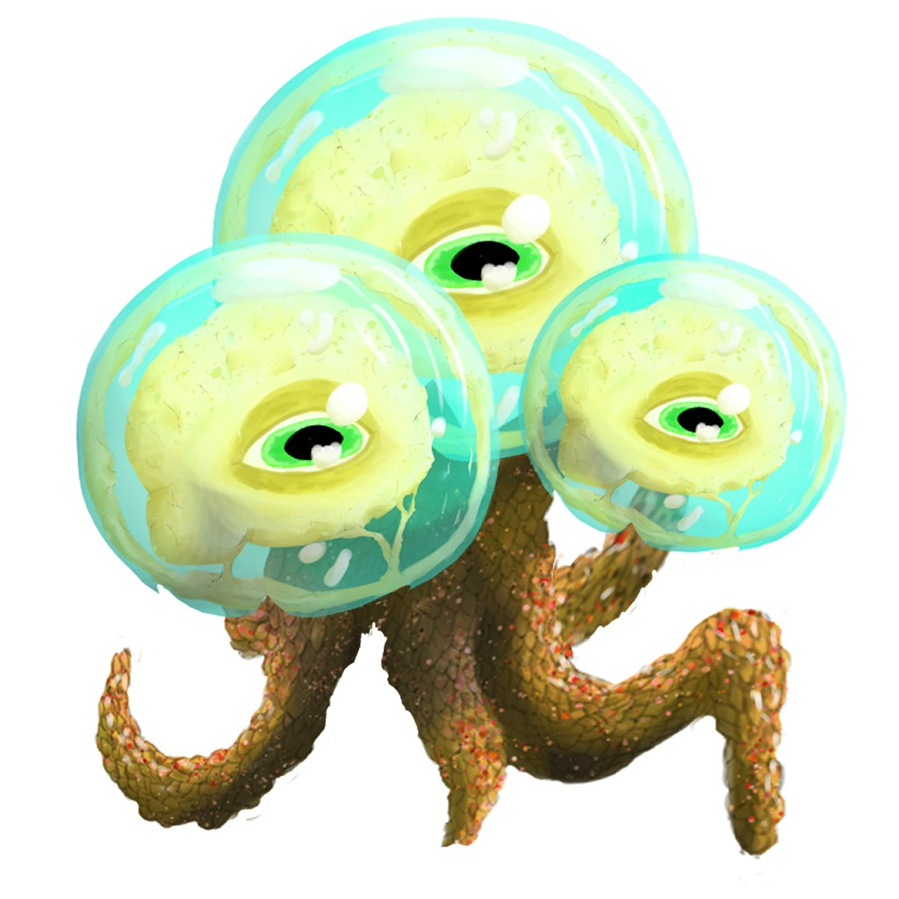 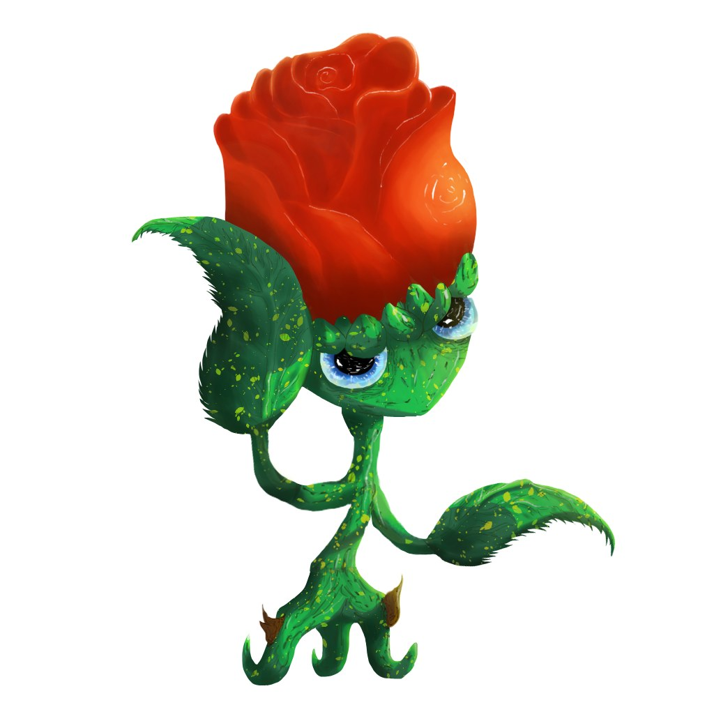

## Ablation

FID after adding each change cumulatively, across five dataset sizes (lower is better). The bottom row is the full dare_GAN.

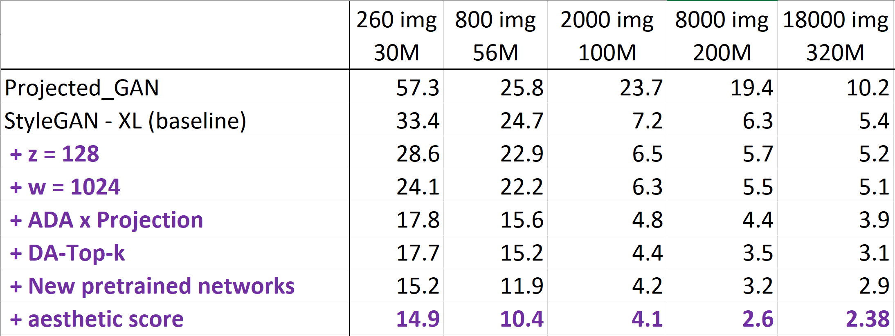

Sweep over latent sizes z × w (ranked by FID and recall). z ≈ 96–128 with w = 1024 came out best:

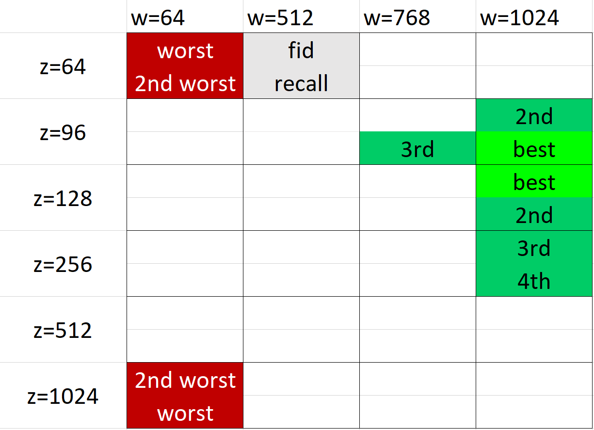

## What's different from StyleGAN-XL

- **Larger latent spaces:** z = 128 (vs 64) and w = 1024 (vs 512). Experiments with StyleGAN3-T synthesis layers suggested that the original dimensions were tuned under unrepresentative conditions. The larger w also gives finer control over truncation.
- **A new conditioning vector y (32-d), optional.** It encodes game-specific attributes such as speed or hit points. The same seed can then be rendered as a "fast" or "slow" variant of a creature, with changes a human sees as logical.
- **Diversity-aware top-k gradients.** Generator gradients are kept or dropped based on both the quality and the diversity of each sample. The kept fraction anneals toward about 75% after 2,000 kimg.
- **Staged discriminator unfreezing.** Low discriminator layers that StyleGAN-XL keeps frozen start learning at half rate once the model reaches 50% recall. This improves quality on unusual datasets without losing diversity.
- **Stronger projector:** DeiT ViT-B → ViT-H/16, with LAION-2B weights plus ResNet-50 for evaluation.
- **Dataset re-weighting by aesthetic score.**
- **Adaptive initial blur.** StyleGAN-XL's default blur schedule caused discriminator collapse on about 70% of the datasets I tried.
- **Translocation regularisation** on low layers only, plus ADA augmentation.

## Trained models

| Model | Params | VRAM | Data | Resolution |
|---|---|---|---|---|
| outer-v5 | 28M | 2 GB | 260 images | 512² |
| poke-v7 | 56M | 4 GB | 800 Pokémon | 256² |
| creature-small | 100M | 8 GB | 2,000 game creatures | 128² |
| creature-mid | 240M | 16 GB | 8,000 game creatures | 256² |
| creature-large | 320M | 24 GB | 18,000 game creatures | 1024² |
| pixelart-tools | 23M | 2 GB | 1,400 pixel-art items | 32² |

## Hardware

Trained on a multi-GPU setup I built myself: RTX A6000 48 GB, RTX 3090, 4× RTX 3060 12 GB, and Radeon Pro Vega II Duo.

## Code

The training code is not public. I'm happy to walk through the architecture and training setup in detail.

## Author

Zsombor Cservid · cservidzsombor@gmail.com
